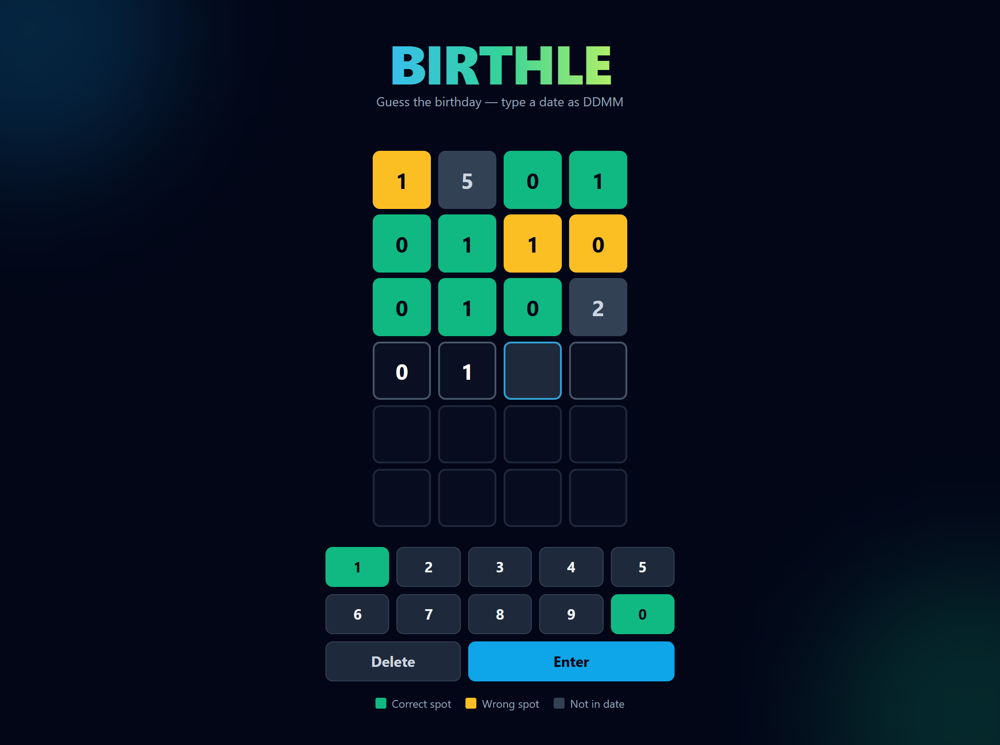
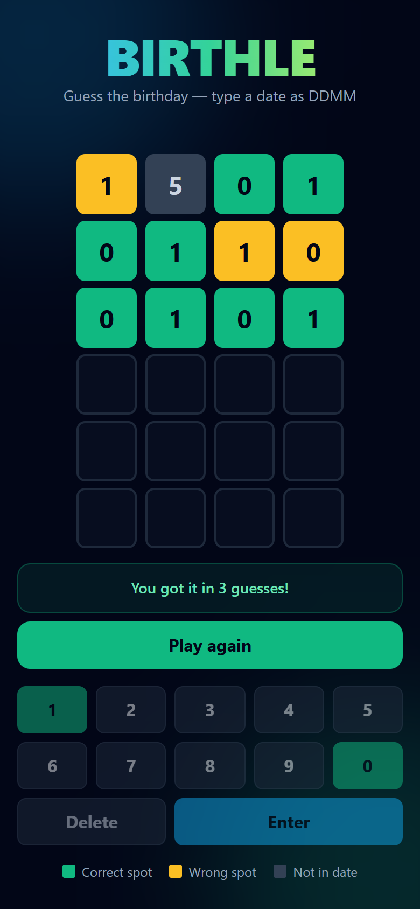

# Birthle

A Wordle-style game where you guess a birth date. Enter a day and month as four digits (`DDMM`) and use the coloured tiles to close in on the answer in six guesses.

<p align="center">
  
  
</p>

## How to play

- Type a date as `DDMM` — for example, `1501` is 15 January.
- Press **Enter** (or use the on-screen keypad) to submit.
- Each digit is scored independently:
  - <strong>Green</strong> — correct digit in the correct position.
  - <strong>Yellow</strong> — the digit exists in the date but in a different position.
  - <strong>Grey</strong> — the digit is not in the date.
- Repeated digits are counted correctly: a guess cannot mark a digit yellow more times than it appears in the answer.
- You have six guesses. The date is revealed if you run out.

## Run locally

```bash
npm install
npm run dev
```

Open [http://localhost:3000](http://localhost:3000).

### Scripts

| Command | Description |
| --- | --- |
| `npm run dev` | Start the development server |
| `npm run build` | Create a production build |
| `npm start` | Serve the production build |
| `npm test` | Run the scoring tests |

## Tech stack

- [Next.js](https://nextjs.org/) (Pages Router)
- [React](https://react.dev/)
- [TypeScript](https://www.typescriptlang.org/)
- [MobX](https://mobx.js.org/) with `mobx-react-lite`
- [Tailwind CSS](https://tailwindcss.com/)

## Project structure

```text
components/     Board, keypad, and legend
lib/            Date scoring logic and tests
pages/          Game page
stores/         Puzzle state
docs/screenshots/  README screenshots
```

## Notes

- Dates use day-month order (`DDMM`), not month-day.
- Only real dates are accepted, including 29 February.
- The answer is chosen in the browser, so this is a casual game rather than a cheat-proof daily puzzle.
